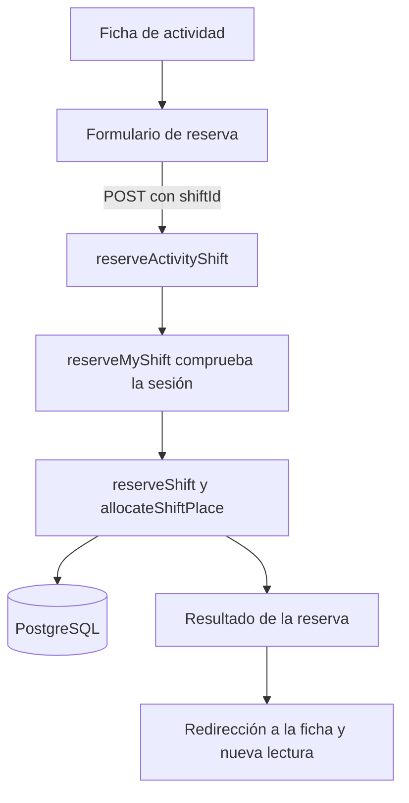

# Backend de Comunidad con Next.js

Comunidad usa el App Router de Next.js 16.4.6. Las pantallas React propias son archivos `.jsx` y la lógica de servidor está principalmente en TypeScript. La aplicación consulta PostgreSQL con Drizzle y usa Neon Auth para identificar al usuario. Las pruebas locales usan PGlite y un proveedor de autenticación de pruebas.

## Por dónde empezar

| Quiero entender… | Leer |
| --- | --- |
| Actividades, turnos, aforo, reservas y asistencia | [Actividades y asistencia](activities.md) |
| Gestión administrativa de cuentas, capacidades y estado | [Cuentas](accounts.md) |
| Catálogo, publicación y marcadores | [Oportunidades](opportunities.md) |
| Perfil básico, talento y privacidad | [Perfiles](profiles.md) |
| Alta UC3M, sesión, verificación y recuperación por código | [Autenticación](auth.md) |

## Una lectura empieza en `page.jsx`

Las carpetas de `src/app` definen la URL. Por ejemplo, [`activities/page.jsx`](../../src/app/activities/page.jsx) sirve `/activities`, y [`activities/[id]/page.jsx`](../../src/app/activities/%5Bid%5D/page.jsx) sirve `/activities/<id>`. En el segundo caso Next.js entrega `params` con el identificador del segmento y `searchParams` con los valores de la consulta. La página espera ambas promesas con `await`. Mantén las escrituras, como consumir un código o guardar una reserva, en acciones que se ejecutan al enviar el formulario.

Las páginas son *Server Components* por defecto. Pueden llamar directamente a una operación de servidor. La operación comprueba el acceso y consulta el repositorio antes de que la página renderice JSX. Los componentes con `"use client"` permiten añadir estado local, eventos y APIs del navegador. Un ejemplo es el [lector QR](../../src/app/admin/attendance/%5BshiftId%5D/scanner.jsx), que necesita la cámara del dispositivo. [Componentes de servidor y cliente · Next.js](https://nextjs.org/docs/app/getting-started/server-and-client-components)

## Una escritura pasa por una Server Action

Un archivo `actions.ts` con `"use server"` exporta funciones asíncronas que se ejecutan en el servidor. Cuando un formulario usa `<form action={miAccion}>`, Next.js tramita el envío como un POST y pasa a la acción un `FormData` con los controles enviados. El atributo `name` de cada control determina la clave que se lee con `formData.get(...)`. El valor puede ser un texto, un archivo o `null`.

La acción vuelve a comprobar la identidad y los permisos, incluso cuando la página ya los verificó. Un usuario puede abrir dos pestañas y enviar un formulario con datos antiguos. Trata los identificadores y campos ocultos como datos de entrada. La cuenta que actúa se obtiene de la sesión en el servidor. [Mutaciones y formularios · Next.js](https://nextjs.org/docs/app/getting-started/mutating-data)

### Sigue una reserva desde el botón hasta PostgreSQL

1. `ActivityPage` consulta con `getMyVisibleActivity(id)`. Esa operación obtiene el usuario con `requireUser` y llama a `getActivity(id, user.personId)`. La página llama a `notFound()` si falta la actividad. Prepara la acción con `reserveActivityShift.bind(null, activity.id)`. El primer argumento queda asociado a esa ficha y el formulario aporta el segundo, `FormData`. [Página de actividad](../../src/app/activities/%5Bid%5D/page.jsx)
2. `ShiftCard` calcula si muestra «Reservar plaza» a partir del horario, el aforo visible y la reserva del usuario. El formulario envía `shiftId` en un campo oculto. [Formulario de reserva](../../src/app/activities/%5Bid%5D/page.jsx)
3. `reserveActivityShift` lee `shiftId` y se lo pasa a `reserveMyShift`. La operación vuelve a exigir una sesión, comprueba el valor y llama a `reserveShift(activityId, shiftId, user.personId)`. Si falta el turno en el formulario, devuelve `missing`. [Acción de reserva](../../src/app/activities/%5Bid%5D/actions.ts) · [Operaciones del portal](../../src/server/activities/portal.ts)
4. `reserveShift` delega en `allocateShiftPlace`. La asignación abre una transacción, bloquea el turno con `FOR UPDATE` y comprueba el aforo con los datos actuales. Así se arbitra la última plaza cuando dos personas la han visto libre. [Participación](../../src/server/activities/participation.ts) · [Asignación de plazas](../../src/server/activities/booking.ts)
5. La acción redirige a `/activities/<id>?status=...`. La página lee el estado y lo traduce a un mensaje como «Tu plaza está reservada» o «El turno se ha completado». La disponibilidad y la reserva del usuario proceden de la consulta a la base de datos. [Página de actividad](../../src/app/activities/%5Bid%5D/page.jsx)

## Sesión, cookies y permisos

El navegador adjunta las cookies a sus peticiones. En Next.js, `await cookies()` permite leerlas en un Server Component. Para establecerlas o borrarlas, hay que actuar en una función de servidor invocada como acción o en un Route Handler, donde puede escribirse la cabecera `Set-Cookie` de la respuesta. En Comunidad, `currentUser()` resuelve la sesión y el perfil. `requireUser()` envía al inicio de sesión cuando la sesión falta o el perfil ya carece de acceso. [Frontera de sesión](../../src/server/auth/access.ts) · [Cookies · Next.js](https://nextjs.org/docs/app/api-reference/functions/cookies)

En administración, `requireCapability("content_editing")` exige una cuenta activa con esa capacidad. Las operaciones de asistencia exigen `attendance_validation` mediante la misma función, que devuelve la identidad con la que se ejecuta la operación. El acceso administrativo denegado llama a `notFound()`. Cuando una escritura también tiene reglas sobre los datos, como quién puede reservar o cuántas plazas quedan, el repositorio las comprueba en la operación que persiste el cambio. [Control de acceso administrativo](../../src/server/auth/access.ts) · [Operaciones de asistencia](../../src/server/activities/attendance.ts) · [Seguridad de datos · Next.js](https://nextjs.org/docs/app/guides/data-security)

## Redirección, revalidación y errores

- `redirect()` termina la acción y cambia de ruta. Haz las escrituras y la revalidación antes de llamarlo. Next.js implementa la redirección mediante una excepción de control de flujo, por lo que un `catch` general que la englobe puede interceptarla.
- `revalidatePath()` invalida los datos de la ruta indicada. Revisa qué otras pantallas muestran el dato modificado. Por ejemplo, las acciones de administración de actividades llaman a `revalidateActivityPaths()` para actualizar sus vistas de administración, asistencia y catálogo.
- Un turno lleno o un formulario incompleto son resultados previstos. La acción puede usar un `status` o `error` conocido y la vista traducirlo a un mensaje en español. El lector QR usa otra variante. `validateCard` devuelve un mensaje y el componente lo recibe con `useActionState` sin cambiar de página. Una excepción inesperada sigue el manejo de errores de Next.js. `notFound()` activa la vista 404 cuando no existe el recurso o se aplica el criterio de acceso administrativo.

[Acciones administrativas de actividades](../../src/app/admin/activities/actions.ts) · [Acciones de asistencia](../../src/app/admin/attendance/%5BshiftId%5D/actions.ts) · [Página 404 de Comunidad](../../src/app/not-found.jsx) · [Mutaciones · Next.js](https://nextjs.org/docs/app/getting-started/mutating-data) · [Gestión de errores · Next.js](https://nextjs.org/docs/app/getting-started/error-handling)

## Qué archivo tocar

| Cambio | Dónde empezar |
| --- | --- |
| Texto, sitio de un botón o mensaje de resultado | `src/app/<ruta>/page.jsx` y sus componentes |
| Campo de formulario o destino tras enviarlo | El formulario y `src/app/<ruta>/actions.ts`. Las acciones de acceso están en [`src/app/auth-actions.ts`](../../src/app/auth-actions.ts). |
| Identidad y capacidad exigida por una operación | [`server/auth/access.ts`](../../src/server/auth/access.ts) y la operación o página protegida |
| Regla de negocio que debe cumplirse al guardar | Repositorio del módulo en [`src/server`](../../src/server) o [servicio de identidad](../../src/server/auth/service.ts) |
| Tipo de columna, relación o restricción persistente | [`src/db/schema`](../../src/db/schema) y migración de Drizzle en [`drizzle`](../../drizzle) |
| Comportamiento visible de principio a fin | Spec del recorrido en [`e2e`](../../e2e), con el seed PGlite en [`seed-e2e-db.ts`](../../e2e/seed-e2e-db.ts) |

Al cambiar una regla, localiza primero la prueba junto al repositorio o servicio y luego el spec que pasa por la pantalla. Los comandos de prueba están en el [README del proyecto](../../README.md#scripts-y-verificación).
