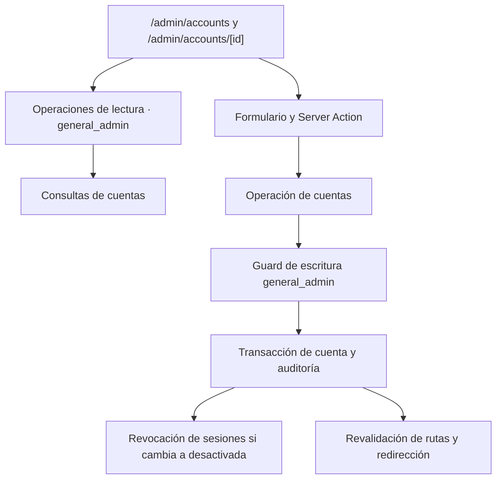

# Cuentas y capacidades

Las páginas JSX de administración muestran las cuentas y sus permisos. Para cambiar una cuenta, el formulario invoca una Server Action. La operación comprueba `general_admin` y toma la identidad del administrador de la sesión. PostgreSQL aplica el cambio y la auditoría en la misma transacción. Si se desactiva una cuenta, la operación revoca después sus sesiones.

## [`src/server/accounts/repository.ts`](../../src/server/accounts/repository.ts)

| Función | Parámetros | Retorno o efecto | Llamada y relación con Next.js |
| --- | --- | --- | --- |
| `resolveDb` | Conexión `db` opcional | Devuelve esa conexión o abre la configurada en la aplicación. | Ayudante privado de las consultas y escrituras. Permite a las pruebas usar PGlite. |
| `getAdminMetrics` | `db` opcional | Cuenta perfiles por estado, supresiones abiertas y reservas y asistencias por turno. | `loadAdminDashboard` la llama si la sesión tiene `general_admin`. |
| `searchAccounts` | Filtros opcionales de texto, titulación, curso, estado y participación. `db` opcional. | Devuelve resúmenes con capacidades y recuentos de reservas y asistencias. | `searchAdminAccounts` la llama tras comprobar `general_admin`. La página aporta los filtros de `searchParams`. |
| `getAccountAdminDetail` | Identificador `profileId` y `db` opcional | Devuelve la ficha con reservas, capacidades, auditoría y supresiones. Devuelve `null` si no hay ficha. | `getAdminAccount` la llama tras comprobar `general_admin`. La página usa `notFound()` si falta la cuenta. |
| `isOnlyActiveGeneralAdminLocked` | Transacción `tx` y perfil objetivo | Bloquea en orden las filas de administradores generales y devuelve si el objetivo es el único activo. | Ayudante privado de revocación de `general_admin` y desactivación. |
| `setProfileCapability` | Perfil objetivo, capacidad, booleano `enabled`, perfil actor y `db` opcional | Concede o revoca la capacidad y audita los cambios. Devuelve el resultado, si hubo cambio o el error `last_general_admin` cuando corresponde. | `changeAccountCapability` le pasa la identidad de sesión. Las pruebas llaman a esta función con una base aislada. |
| `setProfileStatus` | Perfil objetivo, nuevo estado, perfil actor, callback de revocación opcional y `db` opcional | Actualiza y audita el estado, protege al último administrador general activo y llama al callback tras confirmar un cambio a `deactivated`. | `changeAccountStatus` aporta al administrador de sesión y la revocación del proveedor de autenticación. |

## [`src/server/accounts/operations.ts`](../../src/server/accounts/operations.ts)

| Función | Parámetros | Retorno o efecto | Llamada y relación con Next.js |
| --- | --- | --- | --- |
| `changeAccountCapability` | Identificador objetivo, código de capacidad y booleano | Exige `general_admin`, valida el identificador presente y el código, y delega la escritura. Devuelve `null` si faltan esos datos o el código es inválido. | Llamada por `toggleAccountCapabilityAction` desde el formulario de ficha. |
| `changeAccountStatus` | Identificador objetivo y estado `active` o `deactivated` | Exige `general_admin`, delega el cambio y conecta la revocación de sesiones. Devuelve `null` cuando falta el identificador. | Llamada por `setAccountStatusAction` desde la ficha. |

## [`src/app/admin/accounts/actions.ts`](../../src/app/admin/accounts/actions.ts)

| Función | Parámetros | Retorno o efecto | Llamada y relación con Next.js |
| --- | --- | --- | --- |
| `readField` | Formulario y nombre del campo | Devuelve el texto recortado o una cadena vacía. | Ayudante privado de ambas Server Actions. |
| `toggleAccountCapabilityAction` | `FormData` con `accountId`, `capability` y `enabled` | Delega el cambio, revalida la ficha, el listado y el panel, y redirige con el resultado. | Server Action del formulario de capacidades de la ficha. |
| `setAccountStatusAction` | `FormData` con `accountId` y `status` | Interpreta el estado, delega el cambio, revalida las mismas rutas y redirige con el resultado. | Server Action del botón de activación o desactivación de la ficha. |

## Páginas servidor JSX

| Función | Parámetros | Retorno o efecto | Punto de entrada |
| --- | --- | --- | --- |
| `AdminPage` | Ninguno | Usa `loadAdminDashboard` para recibir las capacidades y los datos autorizados. Renderiza los módulos que correspondan. | [`/admin`](../../src/app/admin/page.jsx) |
| `AdminAccountsPage` | `searchParams` con filtros opcionales | Construye filtros y llama a `searchAdminAccounts`, que protege la lectura. | [`/admin/accounts`](../../src/app/admin/accounts/page.jsx) |
| `AdminAccountDetailPage` | `params.id` y `searchParams` de mensaje | Llama a `getAdminAccount`, que protege la lectura, y presenta la ficha y sus formularios. | [`/admin/accounts/[id]`](../../src/app/admin/accounts/%5Bid%5D/page.jsx) |

## Lecturas autorizadas en `operations.ts`

Estas funciones se ejecutan en el servidor. La página las llama directamente para renderizar. La función comprueba la sesión o la capacidad antes de consultar los datos.

| Función | Parámetros | Uso y resultado |
| --- | --- | --- |
| `loadAdminDashboard` | Sin parámetros | Protege `/admin` con `requireAdminAny`. Devuelve las capacidades, las métricas para `general_admin` y los turnos para `attendance_validation`. `AdminPage` usa el resultado para renderizar el panel. |
| `searchAdminAccounts` | `filters` de tipo `AccountSearchFilters` | La página de cuentas pasa los filtros de búsqueda y paginación. Exige `general_admin` antes de llamar a `searchAccounts`. |
| `getAdminAccount` | `id` del perfil solicitado | La página de detalle obtiene la ficha con `getAccountAdminDetail` tras exigir `general_admin`. Devuelve la ficha o `null` para que la página muestre 404. |
