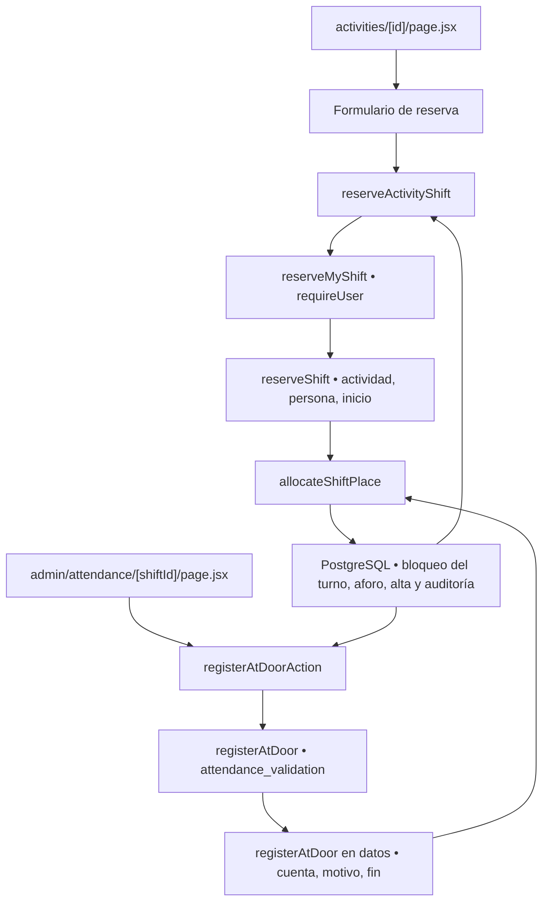

# Actividades, reservas y asistencia

Las páginas de App Router en `src/app/` renderizan el catálogo, las reservas, el panel y la tarjeta. Los formularios JSX envían datos a Server Actions. Cada acción convierte `FormData` al contrato del módulo y elige cómo mostrar el resultado. Las entradas de `src/server/activities/` verifican la sesión o la capacidad antes de acceder a los datos. La regla de negocio y las transacciones viven junto a las consultas Drizzle en ese mismo directorio.



Por ejemplo, la página de detalle vincula el ID de la actividad antes de entregar la acción al formulario. Este fragmento muestra el recorrido con un campo oculto para el turno.

```jsx
const reserve = reserveActivityShift.bind(null, activity.id);

<form action={reserve}>
  <input type="hidden" name="shiftId" value={shift.id} />
  <button type="submit">Reservar plaza</button>
</form>
```

Next.js entrega `FormData` a `reserveActivityShift`, que pasa `shiftId` a `reserveMyShift`. El servidor toma el ID de persona de la sesión, valida los IDs y adjudica la plaza. La acción redirige a `/activities/<id>?status=reserved` cuando se confirma. Ante un turno completo, devuelve `status=full` y la página muestra el mensaje correspondiente. Los IDs enviados por el formulario se vuelven a validar en el servidor.

En PostgreSQL, `allocateShiftPlace` bloquea la fila de `shifts` con `FOR UPDATE` antes de comprobar ocupación. Portal puede reservar antes del inicio y puerta puede inscribir hasta el fin. Ambas vías requieren una actividad publicada y crean una participación `booked`. Puerta exige además una cuenta verificada y un motivo. La reserva y su evento se escriben en la misma transacción. La asistencia se confirma por separado.

## Páginas y acciones en `src/app/`

Las páginas leen mediante funciones del servidor. Las acciones se ejecutan en el servidor al enviar un formulario. Las acciones del panel revalidan las rutas afectadas antes de redirigir o devolver el estado al escáner. La falta de sesión redirige al inicio de sesión en el portal. La falta de capacidad produce un 404 en el panel.

| Archivo y función | Entrada | Resultado y llamadas |
| --- | --- | --- |
| `home/page.jsx` · `HomePage` | Sin argumentos propios | Llama a `loadMyHome` para mostrar la próxima reserva que se puede abrir y los accesos de la sesión. |
| `activities/page.jsx` · `ActivitiesPage` | Sin argumentos propios | Next renderiza el catálogo con `listMyVisibleActivities`. |
| `activities/[id]/page.jsx` · `ActivityPage` | `params.id`, `searchParams.status` | Next renderiza detalle, turnos y aviso. Usa `getMyVisibleActivity`, llama a `notFound` si falta el detalle y vincula `reserveActivityShift` a la actividad. |
| `activities/[id]/actions.ts` · `reserveActivityShift` | ID vinculado de actividad, formulario con `shiftId` | Llama a `reserveMyShift` y redirige al detalle con el código devuelto. |
| `my-activities/page.jsx` · `MyActivitiesPage` | `searchParams.status` | Next agrupa `listMyReservations` en turnos en curso, futuras reservas e historial. Las tarjetas muestran los formularios que permite el servidor. |
| `my-activities/actions.ts` · `cancelActivityReservation` | Formulario con `shiftId` | Llama a `cancelMyReservation` y redirige a Mis actividades con el resultado. |
| `my-activities/actions.ts` · `changeActivityShift` | Formulario con `fromShiftId` y `toShiftId` | Llama a `changeMyReservation` y redirige a Mis actividades con el resultado. |
| `qr-card/page.jsx` · `CardPage` | `searchParams.status` | Next renderiza la tarjeta propia. Llama a `issueMyCard` y pasa el token a `QRCode.toDataURL`. |
| `qr-card/actions.ts` · `reissueMyCard` | Sin campos de formulario | Llama a la operación homónima del módulo y redirige a `/qr-card?status=reissued`. |
| `admin/activities/page.jsx` · `AdminActivitiesPage` | Parámetros de búsqueda para avisos | Next renderiza actividades y turnos mediante `listAdminActivities` y conecta los formularios de edición. |
| `admin/attendance/page.jsx` · `AdminAttendanceIndexPage` | Sin argumentos propios | Next renderiza el índice con `listShiftSummaries`. |
| `admin/attendance/[shiftId]/page.jsx` · `AttendancePage` | `params.shiftId`, búsquedas de personas y estados de formularios | Next llama a `getAttendanceShift`, devuelve 404 si falta y renderiza asistentes, inscritos en puerta y auditoría. Pasa `validateCard` al componente cliente `Scanner`. |

### Acciones privadas de edición en `admin/activities/actions.ts`

| Función | Entrada | Resultado y llamadas |
| --- | --- | --- |
| `readField` | Formulario, nombre de campo | Las acciones de edición reciben texto recortado o cadena vacía. |
| `parseTimestamp` | Texto de fecha | Crear actividad y añadir turno reciben milisegundos o `NaN` para que la capa de datos valide el horario. |
| `revalidateActivityPaths` | Sin parámetros | Las acciones de edición invalidan con `revalidatePath` las vistas del catálogo y del panel relacionadas con actividades. |
| `createAdminActivityAction` | Formulario con título, descripción, lugar, estado, turno e imágenes opcionales | Convierte los campos, llama a `createAdminActivity`, revalida y redirige con `created` o el error. |
| `addActivityShiftAction` | Formulario con actividad, nombre, horario y aforo | Llama a `addActivityShift`, revalida y redirige con `shift_added` o el error. |
| `addActivityImageAction` | Formulario con actividad, URL, texto alternativo y posición | Llama a `addActivityImage`, revalida y redirige con `image_added` o el error. |
| `updateShiftCapacityAction` | Formulario con turno y aforo | Llama a `updateShiftCapacity`, revalida y redirige con `capacity_updated` o el error. |
| `deleteShiftAction` | Formulario con turno | Llama a `deleteShift`, revalida y redirige con `shift_deleted` o el error. |
| `setActivityStatusAction` | Formulario con actividad y estado | Llama a `setActivityStatus`, revalida y redirige con `activity_<estado>` o el error. |

### Acciones de asistencia en `admin/attendance/[shiftId]/actions.ts`

| Función | Entrada | Resultado y llamadas |
| --- | --- | --- |
| `readField` | Formulario, nombre de campo | Las acciones manuales reciben texto recortado o cadena vacía. |
| `revalidateAttendancePaths` | ID de turno | Las acciones de asistencia invalidan el detalle, el panel y Mis actividades con `revalidatePath`. |
| `validateCard` | ID de turno vinculado, estado previo del escáner, formulario con token | El escáner recibe un mensaje del resultado de `validateAttendanceCard`. Revalida las vistas cuando el token supera la verificación. |
| `registerAtDoorAction` | Formulario con turno, cuenta objetivo y motivo | Llama a `registerAtDoor`, revalida y redirige con `door=registered` o el error. |
| `confirmManualAttendanceAction` | Formulario con turno, persona y motivo | Llama a `manualConfirmAttendance`, revalida y redirige con `manual=confirmed` o el error. |
| `correctAttendanceAction` | Formulario con turno, persona, estado destino y motivo | Llama a `correctAttendance`, revalida y redirige con `manual=reverted`, `manual=confirmed` o el error. |

## Entradas protegidas en `src/server/activities/`

`portal.ts` y `card.ts` llaman a `requireUser`. `admin.ts` pide `content_editing` y `attendance.ts` pide `attendance_validation` mediante `requireCapability`. Las funciones que registran quién hizo la operación obtienen el actor de la sesión.

| Archivo y función | Entrada | Resultado y delegación |
| --- | --- | --- |
| `portal.ts` · `listMyVisibleActivities` | Sin argumentos | El catálogo recibe las actividades publicadas de `listActivities`, con la reserva de la persona conectada en cada turno. |
| `portal.ts` · `getMyVisibleActivity` | ID o slug | El detalle recibe la actividad publicada de `getActivity` o `undefined`. |
| `portal.ts` · `listMyReservations` | Sin argumentos | Mis actividades recibe el resultado de `listReservations` para la persona conectada. |
| `portal.ts` · `loadMyHome` | Sin argumentos | Devuelve la sesión y la primera reserva futura de una actividad publicada en `listReservations`. Con sesión ausente, `requireUser` conserva `/home` como retorno. |
| `portal.ts` · `reserveMyShift` | ID de actividad, campo de turno | La acción recibe `missing` si el campo no es texto válido para el contrato. Si es texto, `reserveShift` valida el turno y devuelve el resultado. |
| `portal.ts` · `cancelMyReservation` | Campo de turno | La acción recibe `missing` o el resultado de `cancelReservation` para la persona conectada. |
| `portal.ts` · `changeMyReservation` | Campos de turno origen y destino | La acción recibe `missing` o el resultado de `changeReservation` para la persona conectada. |
| `card.ts` · `issueMyCard` | Sin argumentos | La página recibe el token y la versión de `issueCard`. La propiedad `holderName` contiene el nombre de la persona de la sesión, que la página muestra bajo la tarjeta. |
| `card.ts` · `reissueMyCard` | Sin argumentos | La acción llama a `reissueCard` para incrementar la versión y puede recibir el token nuevo. |
| `admin.ts` · `listAdminActivities` | Sin argumentos | La página recibe la lista del método homónimo de `admin-data.ts`. |
| `admin.ts` · `createAdminActivity` | Campos validados por la operación de datos | La acción recibe la actividad creada o un código de error de `admin-data.ts`. |
| `admin.ts` · `addActivityShift` | ID de actividad, horario, nombre y aforo | La acción recibe el turno creado o un código de error de `admin-data.ts`. |
| `admin.ts` · `addActivityImage` | ID o slug de actividad, URL, texto alternativo, posición | La acción recibe `saved` o un código de error de `admin-data.ts`. |
| `admin.ts` · `updateShiftCapacity` | ID de turno, aforo o `null` | La acción recibe el nuevo aforo o un código de error de `admin-data.ts`. |
| `admin.ts` · `deleteShift` | ID de turno | La acción recibe el ID eliminado o un código de error de `admin-data.ts`. |
| `admin.ts` · `setActivityStatus` | ID de actividad, estado destino | La acción recibe el estado aplicado o un código de error de `admin-data.ts`. |
| `attendance.ts` · `listShiftSummaries` | Sin argumentos | El índice de asistencia recibe los turnos y sus conteos de `attendance-data.ts`. |
| `attendance.ts` · `getAttendanceShift` | ID de turno, búsqueda de asistentes, búsqueda de cuentas para puerta | El detalle recibe `null` si falta el turno. Usa `getShiftDetail` para los conteos y consulta los asistentes, candidatos y auditoría en paralelo. |
| `attendance.ts` · `validateAttendanceCard` | ID de turno, token recibido | La acción recibe `invalid_card` si `verifyCard` no reconoce la tarjeta. Llama a `checkIn` para el resultado de asistencia de un QR válido. |
| `attendance.ts` · `registerAtDoor` | ID de turno, ID de cuenta objetivo, motivo | La acción recibe una participación `booked` o un error del método homónimo de `attendance-data.ts`. |
| `attendance.ts` · `manualConfirmAttendance` | ID de turno, ID de persona y motivo | La acción recibe la confirmación o un código de error de `attendance-data.ts`. |
| `attendance.ts` · `correctAttendance` | ID de turno, ID de persona, estado destino y motivo | La acción recibe la transición o un código de error de `attendance-data.ts`. |

## Consultas, reglas y transacciones

Las operaciones de datos usan `resolveDb` para obtener la conexión. Las pruebas pueden pasar una base PGlite como argumento `db`. Los tipos de entrada y resultado están junto a la función que los interpreta. En `src/db/schema/activities.ts` viven las claves, restricciones y relaciones del esquema.

### Lecturas del portal en `portal-data.ts`

| Función | Entrada | Resultado y llamadas |
| --- | --- | --- |
| `loadImagesByActivityIds` | Conexión, IDs de actividades | Para catálogo y detalle, consulta `activityImages` y agrupa imágenes por actividad. El orden por posición deja la portada primero. |
| `loadShiftsByActivityIds` | Conexión, IDs de actividades, ID de persona | Para catálogo, detalle y reservas, agrupa turnos con ocupación, plazas calculadas por `computeAvailable` y estado de la reserva propia. |
| `listActivities` | ID de persona, `db` opcional | `listMyVisibleActivities` recibe las actividades publicadas con imágenes y turnos mediante los dos auxiliares anteriores. |
| `getActivity` | ID o slug, ID de persona, `db` opcional | `getMyVisibleActivity` recibe el detalle publicado por ID o slug, o `undefined`. Consulta los dos auxiliares anteriores. |
| `listShifts` | `db` opcional | El enlace rápido de `/admin` recibe turnos y actividades ordenados por fecha tras comprobar la capacidad de asistencia. |
| `listReservations` | ID de persona, `db` opcional, fecha de referencia opcional | `listMyReservations` y `loadMyHome` reciben las reservas ordenadas por inicio. Incluye su estado editorial, el grupo de agenda según el horario y la asistencia, y las opciones de cambio y cancelación. Usa `loadShiftsByActivityIds` para los destinos de actividades publicadas. |

### Adjudicación y reservas en `booking.ts` y `participation.ts`

| Archivo y función | Entrada | Resultado y llamadas |
| --- | --- | --- |
| `booking.ts` · `checkSeatAvailability` | Transacción con turno bloqueado, ID de turno, ID de persona, aforo | `allocateShiftPlace` y `changeReservation` reciben `duplicate`, `full` o `available` según las participaciones existentes. |
| `booking.ts` · `allocateShiftPlace` | Turno, persona y datos de origen, fecha, `db` opcional | `reserveShift` y `registerAtDoor` comparten el bloqueo de turno, la comprobación de publicación y plazas, y el alta con su evento. Usa `profileExists` para el actor de puerta y `checkSeatAvailability` para el aforo. Devuelve el ID y el nombre de la persona o un error de adjudicación. |
| `participation.ts` · `reserveShift` | ID o slug, turno, persona, fecha y `db` opcionales | El portal y el seed reciben un código de reserva. Valida identificadores, llama a `allocateShiftPlace` con origen `portal` y traduce sus resultados. |
| `participation.ts` · `cancelReservation` | Persona, turno, fecha y `db` opcionales | `cancelMyReservation` recibe un código de cancelación. Bloquea turno y participación, elimina la plaza antes del inicio y conserva el evento `cancelled`. |
| `participation.ts` · `changeReservation` | Persona, turnos origen y destino, fecha y `db` opcionales | `changeMyReservation` recibe un código de cambio. Bloquea ambos turnos por ID, usa `checkSeatAvailability` y mueve la misma participación en la actividad publicada. El evento `changed` conserva los dos turnos. |
| `participation.ts` · `checkIn` | Turno, persona, organizador, fecha y `db` opcionales | `validateAttendanceCard` recibe un código de asistencia. Comprueba la cuenta, bloquea la participación, registra método `qr` y emite `attendance_qr` una sola vez. |

### Gestión de actividades y turnos en `admin-data.ts`

| Función | Entrada | Resultado y llamadas |
| --- | --- | --- |
| `toValidDate` | Fecha, milisegundos o valor ausente | Las escrituras de turnos reciben una fecha válida o `null`. |
| `cleanOptionalText` | Texto opcional, longitud máxima opcional | El alta de turno y `parseOptionalHttpsUrl` reciben texto recortado o `null`. |
| `isValidHttpsUrl` | Texto de URL | La validación de imágenes iniciales y `parseOptionalHttpsUrl` comprueban HTTPS, longitud, caracteres y host. |
| `parseOptionalHttpsUrl` | URL externa opcional | `createAdminActivity` recibe resultado de validación y URL o ausencia. Usa `cleanOptionalText` e `isValidHttpsUrl`. |
| `generateSlug` | Título de actividad | `createAdminActivity` recibe un slug normalizado con sufijo aleatorio. |
| `normalizeExplicitSlug` | Slug indicado por quien llama | `createAdminActivity` recibe el slug normalizado o `null`. |
| `isPgErrorCode` | Error capturado, código PostgreSQL esperado | `addActivityImage` reconoce la colisión de posición aunque Drizzle envuelva el error. |
| `readAdminActivityShifts` | Conexión o transacción, IDs de actividad | `listAdminActivities` recibe los turnos agrupados con reservas, asistentes y plazas de `computeAvailable`. |
| `readAdminActivityImages` | Conexión o transacción, IDs de actividad | `listAdminActivities` recibe imágenes agrupadas y ordenadas por posición. |
| `listAdminActivities` | `db` opcional | La entrada de edición recibe actividades de todos los estados con turnos e imágenes a través de los dos auxiliares anteriores. |
| `createAdminActivity` | Campos de actividad, turnos e imágenes, ID del actor, `db` opcional | La entrada de edición y el seed reciben la actividad o un error de validación. Valida estado, sitio externo, slug, aforo e imágenes, comprueba `profileExists` y escribe actividad, turnos, imágenes y auditoría juntos. |
| `addActivityShift` | ID de actividad, horario, nombre, lugar opcional y aforo, `db` opcional | La entrada de edición recibe el turno o un error. Usa `toValidDate` y `cleanOptionalText` y comprueba la actividad antes de insertar. |
| `updateShiftCapacity` | Turno, aforo nuevo o `null`, `db` opcional | La entrada de edición recibe el nuevo aforo o un error. Bloquea el turno y rechaza aforos inferiores a la ocupación. |
| `deleteShift` | Turno, `db` opcional | La entrada de edición recibe el ID eliminado o un error. Bloquea el turno y comprueba participantes y auditoría antes de borrarlo. |
| `setActivityStatus` | Actividad, estado, actor, `db` opcional | La entrada de edición recibe el estado o un error. Comprueba `profileExists`, bloquea la actividad y exige al menos un turno válido para publicar. Guarda el cambio con auditoría. |
| `addActivityImage` | ID o slug, URL, texto alternativo y posición, `db` opcional | La entrada de edición recibe `saved` o un error. Valida el contenido e inserta la imagen. `isPgErrorCode` traduce una colisión de posición concurrente. |

### Asistencia en `attendance-data.ts`

| Función | Entrada | Resultado y llamadas |
| --- | --- | --- |
| `queryShiftSummaries` | Conexión, ID de turno opcional | `listShiftSummaries` y `getShiftDetail` reciben datos y conteos de turnos con plazas de `computeAvailable`. |
| `listShiftSummaries` | `db` opcional | La entrada de asistencia recibe todos los turnos ordenados por fecha mediante `queryShiftSummaries`. |
| `getShiftDetail` | ID de turno, `db` opcional | `getAttendanceShift` recibe un turno de `queryShiftSummaries` o `null`. |
| `listShiftAttendeesDetailed` | Turno, texto de búsqueda y `db` opcionales | `getAttendanceShift` recibe participaciones y datos mínimos de cuenta filtrados por nombre, correo o ID. Usa `formatName`. |
| `listActiveAccountsForDoor` | Turno, texto de búsqueda y `db` opcionales | `getAttendanceShift` recibe cuentas activas y verificadas con indicador de reserva. Usa `formatName` y filtra por nombre, correo o titulación. |
| `registerAtDoor` | Turno, cuenta objetivo, actor, motivo, fecha y `db` opcionales | La entrada de asistencia recibe un alta `booked` o un error. Valida motivo obligatorio y llama a `allocateShiftPlace` con origen `door`. |
| `manualConfirmAttendance` | Turno, persona, actor, motivo, fecha y `db` opcionales | La entrada de asistencia recibe una confirmación o un error. Bloquea la participación, comprueba cuenta y actor, guarda método `manual` y añade `attendance_manual`. |
| `correctAttendance` | Turno, persona, estado destino, actor, motivo, fecha y `db` opcionales | La entrada de asistencia recibe una transición o un error. Bloquea y actualiza la participación. El evento `attendance_corrected` guarda ambos estados y el motivo. |
| `listAttendanceAudit` | Turno, `db` opcional | `getAttendanceShift` recibe eventos de puerta, asistencia, cambios y cancelaciones, enriquecidos con `formatName` y ordenados cronológicamente. |

### Tarjeta en `card-data.ts`

| Función | Entrada | Resultado y llamadas |
| --- | --- | --- |
| `isTestQrFallbackAllowed` | Entorno del proceso | `getCardSecretKey` recibe un booleano. El modo de pruebas admite la clave de pruebas cuando Neon Auth está sin configurar. |
| `getCardSecretKey` | Entorno del proceso | Emisión, reemisión y verificación reciben la clave en bytes o un error de configuración. Usa `isTestQrFallbackAllowed`. |
| `getCardIssuer` | Entorno del proceso | Firma y verificación reciben el emisor configurado o el origen público predeterminado. |
| `signCardToken` | Clave, ID de persona y versión | `issueCard` y `reissueCard` reciben un JWT HS256 con emisor, audiencia de asistencia, sujeto y versión. Usa `getCardIssuer`. |
| `getCardVersion` | ID de persona, `db` opcional | Las pruebas reciben la versión almacenada en `profiles` o `null`. |
| `issueCard` | ID de persona, `db` opcional | `issueMyCard` recibe token y versión. Lee el perfil activo, vinculado y verificado y llama a `signCardToken`. |
| `reissueCard` | ID de persona, `db` opcional | `reissueMyCard` recibe token y nueva versión. Incrementa `profiles.qrVersion` con una sola escritura condicionada y llama a `signCardToken`. |
| `verifyCard` y su alias `readCard` | Token, `db` opcional | La asistencia usa `verifyCard` y las pruebas ejercitan ambas referencias. Devuelve el ID de persona o `null` tras verificar firma, emisor, audiencia, versión y estado de cuenta. |

### Auxiliares y pruebas

| Archivo y función | Entrada | Resultado y llamadas |
| --- | --- | --- |
| `shared.ts` · `resolveDb` | `db` opcional | Los módulos de datos reciben la conexión inyectada o la conexión de `getDb`. |
| `shared.ts` · `computeAvailable` | Aforo y ocupación | Las consultas de turnos reciben plazas disponibles o `null` para aforo ilimitado. |
| `activities.test.ts` · `createProfile` | Base de pruebas y campos opcionales | Crea el perfil que necesitan las pruebas de reserva, cambios y asistencia. |
| `activities.test.ts` · `seedActivityWithShifts` | Base de pruebas y datos de actividad y turnos | Inserta una actividad y sus turnos y devuelve las filas para los casos de catálogo, reserva y concurrencia. |
| `card-data.test.ts` · `insertProfile` | Base de pruebas y campos opcionales | Crea el perfil que necesitan las pruebas de emisión, revocación y verificación. |

Las pruebas de reservas ejecutan ambas solicitudes por la última plaza desde `Promise.all` sobre PGlite y verifican una sola participación y su auditoría. Las de QR comprueban firma, versión y elegibilidad de la cuenta. Las pruebas de navegador recorren los formularios y las respuestas de autorización de Next.js.

## Helpers de presentación del panel

| Función | Parámetros | Resultado y llamador |
| --- | --- | --- |
| `defaultDateTimeInput` | `offsetHours`, horas respecto a la hora local del servidor | La página administrativa de actividades la usa para proponer una hora de turno. Devuelve texto compatible con un campo `datetime-local`. Su helper `pad(value)` rellena mes, día y hora con dos dígitos. |
| `formatAuditStatusSummary` | `entry`, un evento de participación | Resume el cambio de estado o el estado registrado. La página de asistencia lo presenta en el historial. |
