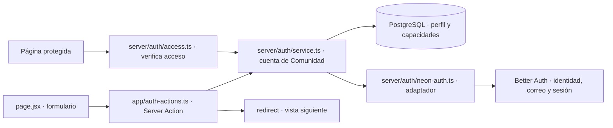

# Cuentas, sesión y códigos por correo

En Comunidad, una página `page.jsx` muestra el formulario. Cuando la persona lo envía, React llama a una **Server Action** exportada desde un archivo con `"use server"`. Next.js la ejecuta en el servidor y entrega los campos como `FormData`. La acción traduce campos, resultados y redirecciones. El servicio decide si Comunidad permite la operación y el adaptador invoca Better Auth gestionado por Neon. [Guía de formularios de Next.js](https://nextjs.org/docs/app/guides/forms) · [SDK de servidor de Neon](https://neon.com/docs/auth/quick-start/nextjs-api-only)

Una identidad de Neon y un perfil de Comunidad se relacionan por `authUserId`. El identificador de perfil se usa para reservas y permisos. La sesión verificada acredita la identidad. El perfil activo y sus capacidades determinan qué puede hacer en Comunidad. Una persona puede tener sesión sin tener permiso para entrar a `/admin`.

## Campos y tipos comunes

- `db` es una conexión `AppDb` de Drizzle. En despliegue apunta a Neon PostgreSQL y en pruebas a PGlite.
- `authProvider` tiene el contrato `AuthProvider`. Las pruebas pueden inyectar un proveedor de prueba sin cambiar el servicio.
- `AuthUser` es lo que consume la aplicación tras resolver la sesión. Incluye los identificadores de perfil e identidad, el nombre, el correo, el estado y las capacidades.
- `next` es un destino interno opcional. Se sanitiza al volver a una pantalla protegida.
- `options.now` fija la hora en una prueba. Cuando se omite se usa la hora actual.
- Los códigos de verificación y recuperación tienen seis dígitos. El servicio mantiene separados propósito, correo e identidad.

## `src/app/auth-actions.ts`

El archivo es el punto de entrada de formularios de autenticación. `redirect()` termina el flujo actual y pide a Next.js navegar. La firma `Promise<never>` indica que la acción termina con esa redirección.

| Función | Parámetros | Efecto y relación |
| --- | --- | --- |
| `readFormString` | `formData` y `key`, el nombre del campo | Ayuda privada usada por las acciones. Devuelve el texto o una cadena vacía cuando falta el campo o es un archivo. La validación efectiva ocurre en el servicio. |
| `redirectWithNext` | Ruta, parámetros de resultado y destino opcional | Ayuda de navegación. Construye la cadena de consulta con el destino interno validado por `readOptionalNextPath` y llama a `redirect`. |
| `accountDestination` | Usuario de Comunidad y destino sanitizado | Si hay destino, lo conserva. Si no, devuelve `/admin` para una cuenta con capacidades o `/home` para el resto. Lo usan acceso y verificación. |
| `signUp` | `FormData` de `/sign-up`, con nombre, apellidos, correo, grado, curso, nivel y modalidad opcionales, contraseña y aceptación del aviso | Obtiene la base y el proveedor, llama a `registerAccount` y redirige con el resultado. Si requiere código, guarda el correo en el contexto de verificación y abre `/verify-email`. |
| `signIn` | `FormData` con correo, contraseña y `next` opcional | Llama a `authenticateAccount`. Continúa al destino si se creó sesión. Si el correo sigue pendiente, lo conserva en la cookie de verificación y dirige al formulario de código. |
| `signOut` | Sin parámetros. Usa la sesión de la petición | La barra de Comunidad envía el formulario de salida. La acción llama al proveedor, elimina la sesión del navegador y vuelve a la portada. |
| `verifyEmailAction` | `FormData` con correo, código y `next` opcional | Llama a `verifyAccountEmail`. En error conserva el correo y vuelve al formulario. En éxito limpia el contexto y continúa si Neon creó sesión, o muestra acceso. |
| `resendVerificationAction` | `FormData` con correo y `next` opcional | Normaliza el correo UC3M y llama a `resendAccountVerification`. Vuelve al formulario con el aviso genérico de reenvío. |
| `requestPasswordResetAction` | `FormData` con correo | Llama a `requestPasswordReset`, guarda el contexto de recuperación y abre `/reset-password`. Ofrece la misma respuesta para solicitudes válidas y no elegibles. |
| `resetPasswordAction` | `FormData` con correo, código, contraseña y confirmación | Llama a `completePasswordReset`. Conserva el contexto si falla. En éxito limpia la cookie temporal, cierra la sesión del navegador y vuelve a acceso. |

Las páginas de alta, acceso, verificación y recuperación importan estas funciones para asignarlas a `<form action={...}>`. La verificación usa `verify-email/view.jsx` para renderizar los formularios y pasarles el correo leído en `verify-email/page.jsx`. La estructura JSX sigue siendo la de la aplicación.

## `src/server/auth/access.ts`

El archivo usa `server-only` para que Next.js impida importarlo desde un componente de cliente. La comprobación vive en el servidor y se hace tanto para páginas protegidas como para operaciones que escriben. El 404 de administración se produce con `notFound()`.

| Función | Parámetros | Efecto y relación |
| --- | --- | --- |
| `currentUser` | Sin parámetros. Lee las cookies de la petición con `cookies()` | Devuelve `null` si no hay usuario válido. Con cookies, obtiene base y proveedor y llama a `resolveCurrentUser`. Lo usan el layout, la portada y las comprobaciones de acceso. |
| `requireUser` | `nextPath?`, destino interno al volver | Llama a `currentUser`. Devuelve `AuthUser` o redirige a acceso, conservando un destino seguro cuando se proporcionó. |
| `requireAdminAny` | Sin parámetros | Devuelve al usuario activo con al menos una capacidad. Si no hay acceso, llama a `notFound()`. Lo usa la portada del panel. |
| `requireCapability` | `capability`, un código de `CapabilityCode` | Devuelve al usuario activo que tiene esa capacidad o produce un 404. Cada módulo pide la capacidad correspondiente a la operación. |
| `revokeUserSessions` | `authUserId`, identificador del proveedor | Pide al adaptador que cierre las sesiones de esa identidad. La desactivación de cuenta lo usa después de persistir el estado local. |

## `src/server/auth/form-context.ts` y `uc3m.ts`

Next.js permite leer cookies en una página de servidor y modificarlas desde una acción. La cookie temporal sirve para rellenar el correo del formulario. La sesión de Better Auth y los códigos OTP tienen su propio ciclo independiente.

| Función | Parámetros | Efecto y relación |
| --- | --- | --- |
| `readAccountCodeEmail` | `flow` es `verification` o `recovery` | Lee la cookie del recorrido, normaliza el correo UC3M y devuelve texto o cadena vacía. La usan las páginas de verificación y recuperación al renderizarse. |
| `setAccountCodeEmail` | `flow` y correo sin normalizar | La acción guarda un correo válido en la cookie correspondiente durante diez minutos. Un valor vacío o inválido caduca esa cookie. Las cookies tienen rutas separadas. |
| `readOptionalNextPath` | Valor de formulario o consulta, de tipo `unknown` | Devuelve el destino únicamente cuando es una ruta interna válida. En caso contrario devuelve una cadena vacía para que el flujo use su destino normal. |
| `normalizeEmail` | Valor bruto de tipo `unknown` | Devuelve un correo válido en minúsculas y sin espacios externos, o `null`. Es la base para validar direcciones en adaptador y servicio. |
| `isUc3mEmail` | Valor bruto de tipo `unknown` | Devuelve si el correo pertenece a `uc3m.es` o un subdominio. Conserva el límite de dominio para que dominios parecidos no coincidan. |
| `normalizeUc3mEmail` | Valor bruto de tipo `unknown` | Combina normalización y requisito UC3M. Devuelve texto normalizado o `null`. |
| `isSafeInternalPath` | Ruta candidata | Ayuda privada de `sanitizeNextPath`. Comprueba que la ruta se resuelva en el mismo origen y que no contenga caracteres ambiguos. |
| `sanitizeNextPath` | Valor bruto y ruta alternativa opcional | Devuelve una ruta local segura. Usa la alternativa si el valor no es seguro y `/home` si la alternativa tampoco lo es. |

## `src/server/auth/service.ts`

El servicio contiene las reglas de Comunidad. Acepta base y proveedor como parámetros para poder probar las reglas con PostgreSQL y un proveedor controlado. Las acciones y el módulo de acceso delegan aquí.

| Función | Parámetros | Efecto y relación |
| --- | --- | --- |
| `registerAccount` | Base, proveedor, datos del perfil, contraseña, aceptación y `options.now?` | Valida correo UC3M, consentimiento y datos de perfil antes de dar de alta en Neon. Vincula o recupera el perfil local en reintentos autorizados. Devuelve identidad, perfil y si requiere verificación, o un error de registro. |
| `verifyAccountEmail` | Base, proveedor, `{email, otp}` y `options.now?` | Comprueba el código con el proveedor y la correspondencia de la identidad verificada con el perfil activo. Guarda la verificación. Devuelve `sessionUser` si el proveedor abrió sesión, o un error de código inválido o vencido. |
| `resendAccountVerification` | Base, proveedor y correo bruto | Solicita a Neon un código de alta para un perfil elegible. Devuelve una respuesta uniforme para preservar la privacidad de la cuenta. |
| `authenticateAccount` | Base, proveedor, correo y contraseña | Comprueba que el perfil esté activo y que el usuario del proveedor coincida con ese perfil. Devuelve usuario y capacidades o un resultado de credenciales o verificación pendiente. |
| `requestPasswordReset` | Base, proveedor y correo bruto | Solicita un código de recuperación para un perfil elegible. La respuesta es uniforme. |
| `completePasswordReset` | Base, proveedor y `{email, otp, password, confirmPassword?}` | Valida datos y elegibilidad y pide al proveedor cambiar la contraseña con el código. Devuelve éxito o error de validación. En Neon, la revocación al cambiar contraseña depende de la configuración de la rama. |
| `resolveCurrentUser` | Base y proveedor | Comprueba una sesión real, correo verificado y perfil de Comunidad activo con identidad y correo concordantes. Carga las capacidades y devuelve `AuthUser` o `null`. Lo usa `currentUser`. |
| `isCapabilityCode` | Valor desconocido | Comprueba si está en la lista de capacidades. Ayuda a validar campos del panel antes de cambiar permisos. |
| `trimmedField` / `optionalTrimmedField` | Longitud máxima | Ayudas privadas que construyen esquemas de texto normalizado. El segundo convierte valores vacíos en `null`. |
| `isPgUniqueViolation` | Error de base de datos | Detecta la violación de unicidad que se traduce a un resultado de cuenta duplicada. |
| `loadCapabilities` | Base e identificador de perfil | Lee capacidades del perfil y las devuelve en el orden conocido por el código. Lo usan acceso y verificación. |
| `buildAuthUser` | Fila de perfil, identidad de Neon y capacidades | Construye el objeto de usuario que necesita Comunidad. |
| `canResetPassword` | Base y correo normalizado | Comprueba que exista un perfil vinculado, activo y con correo verificado. Lo usan ambos pasos de recuperación. |

## `src/server/auth/neon-auth.ts`

El adaptador aísla el SDK. Normaliza datos y errores al contrato de Comunidad. La recuperación usa el handler del SDK con dos rutas determinadas porque la versión instalada carece del helper de solicitud OTP y el helper de confirmación apunta a otra ruta. Se trata de una llamada en memoria desde el servidor, que sigue usando Neon como destino real.

| Función | Parámetros | Efecto y relación |
| --- | --- | --- |
| `getAuthProvider` | `db?` | Obtiene el adaptador real o, solo bajo la configuración de pruebas, construye el proveedor de PGlite. Devuelve `AuthProvider` o falla si falta configuración. |
| `getNeonAuth` | Sin parámetros. Lee la configuración de Auth del servidor | Construye o reutiliza el SDK para la URL y configuración de cookie configuradas. Devuelve el SDK o `null` si faltan variables. |
| `createNeonAuthProvider` | Instancia `NeonAuth` del SDK | Devuelve el conjunto de métodos normalizados de Comunidad. Las pruebas del adaptador también le inyectan un SDK controlado. |
| `mapBetterAuthErrorCode` | Error del SDK con código, mensaje o estado | Convierte errores de Neon a códigos estables que maneja el servicio. |
| `otpFailure` | Error opcional del SDK | Construye un fallo OTP del contrato de Comunidad. |
| `toProviderUser` | Objeto desconocido del SDK | Devuelve la identidad normalizada si puede construirla, o `null`. |
| `postPasswordOtp` | SDK, operación de recuperación y cuerpo de esa operación | Construye una solicitud interna, llama a `handler().POST` y devuelve un resultado de alcance limitado. Se usa para solicitar código o confirmar contraseña. |
| `createNextTestCookieStore` | Sin parámetros | Adapta las cookies de Next al proveedor de prueba. `getToken()` lee la cookie, `setToken(token, maxAgeSeconds)` la escribe y `clearToken()` la borra. |

| Método del adaptador | Entrada y resultado |
| --- | --- |
| `signUp` | Recibe nombre, correo y contraseña. Crea la identidad y devuelve usuario y requisito de verificación o un error normalizado. |
| `signIn` | Recibe correo y contraseña. Inicia sesión con el SDK y devuelve la identidad o un error. |
| `signOut` | Sin parámetros. Termina la sesión de la petición mediante el SDK. |
| `getSession` | Sin parámetros. Lee la sesión con el SDK y devuelve sesión e identidad o `null`. |
| `sendVerificationOtp` | Recibe correo. Solicita el código de verificación. |
| `verifyEmailOtp` | Recibe correo y código. Devuelve identidad verificada y un booleano que indica si se creó una sesión. El token se usa en el SDK y queda fuera del resultado de Comunidad. |
| `requestPasswordResetOtp` | Recibe correo. Llama a `postPasswordOtp` con la operación de solicitud. |
| `resetPasswordWithOtp` | Recibe correo, código y contraseña nueva. Llama a `postPasswordOtp` con la operación de confirmación. |
| `revokeUserSessions` | Recibe la identidad de Neon. Solicita la revocación. La comprobación del estado activo del perfil impide operar aunque el proveedor no pueda revocar de inmediato. |
| `recoverUnlinkedUser` | Recibe correo y contraseña. Comprueba identidad existente en un reintento de alta antes de vincularla al perfil. |

## `src/server/auth/test-auth-provider.ts`

Las suites usan el mismo contrato con una base PGlite desechable. Cada método de `AuthProvider` tiene el mismo propósito y parámetros que en la tabla anterior. El proveedor de pruebas implementa esos métodos sobre sus tablas temporales, un reloj inyectable y un buzón JSONL en las pruebas de navegador.

| Función auxiliar | Parámetros y uso |
| --- | --- |
| `isTestAuthEnabled` / `assertTestAuthAllowed` | Sin parámetros. Comprueban el entorno de ejecución y el primero devuelve un booleano. El segundo falla si se intenta abrir el proveedor fuera de pruebas. |
| `hashPassword` / `verifyPassword` | Contraseña y, al verificar, hash almacenado. Generan o comprueban el valor de pruebas. |
| `generateOpaqueToken` / `hashSessionToken` | Sin parámetros al generar, token bruto al calcular el hash. Preparan el token de sesión y el valor que se almacena. |
| `buildOtpIdentifier` | Propósito y correo. Construye el identificador de búsqueda de un código. |
| `createMemoryCookieStore` | Sin parámetros. Crea un almacén de sesión para pruebas unitarias, con operaciones de lectura, escritura y borrado del token. |
| `ensureTestNeonAuthSchema` | Base de pruebas. Prepara las tablas del proveedor de prueba. |
| `getLatestTestOtp` | Base, correo, propósito y hora opcional. Lee el código vigente de pruebas para que el seed o una suite puedan confirmarlo. |
| `toAuthUser` | Fila de identidad de prueba. La adapta al formato esperado por el servicio. |
| `lockOtpUser` | Transacción y correo. Bloquea la identidad al operar con un código. |
| `issueOtp` / `consumeOtp` | Transacción, propósito, correo y hora. Para consumir se añade el código recibido. Emiten o consumen el código con comprobaciones de tiempo e intentos. |
| `writeTestMailbox` | Mensaje de prueba. Añade el código y su propósito al archivo JSONL cuando está configurado. |
| `createSession` | Transacción, identidad y hora. Inserta la sesión temporal y devuelve el token para el almacén de cookies de la prueba. |
| `createTestAuthProvider` | Base y opciones de reloj o almacén de cookies. Crea el proveedor de prueba. |
| `sendOtp` | Correo y propósito. Ayuda interna del proveedor de prueba para validar, emitir y entregar el código al buzón. |

## Seguir el flujo en una prueba

1. `neon-auth.test.ts` comprueba qué recibe y devuelve el adaptador de Neon, incluidos los endpoints que usa internamente para recuperación.
2. `service.test.ts` comprueba las reglas de registro, códigos, sesión y perfil con PGlite.
3. `test-auth-provider.test.ts` comprueba caducidad, separación de propósito y reenvío.
4. `e2e/email-otp.spec.ts` recorre la página, abre la sesión y comprueba que el portal devuelve 404 en la antigua ruta de proxy. El proveedor de pruebas usa el buzón JSONL. La prueba manual con Neon de desarrollo comprueba entrega a un buzón real y la cookie del proveedor.

[Volver al mapa del backend](README.md)

