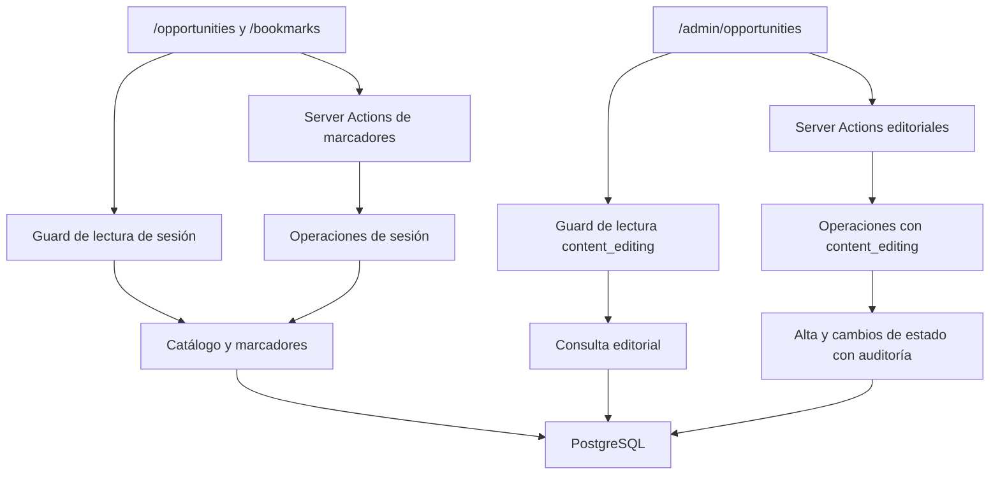

# Oportunidades y marcadores

Los componentes de servidor leen las oportunidades y marcadores de la cuenta activa. Desde el panel, las personas con `content_editing` controlan el alta y el estado de las oportunidades. Los dos recorridos usan el mismo repositorio. Al archivar una oportunidad desaparece del catálogo y permanece en la lista de marcadores con información básica.

## [`src/server/opportunities/repository.ts`](../../src/server/opportunities/repository.ts)

| Función | Parámetros | Retorno o efecto | Llamada y relación con Next.js |
| --- | --- | --- | --- |
| `resolveDb` | `db` opcional | Devuelve esa conexión o abre la de la aplicación. | Ayudante privado del repositorio. Las pruebas usan PGlite. |
| `toValidDate` | Fecha, milisegundos, `null` o `undefined` | Devuelve una fecha válida o `null`. | El alta editorial la usa para fechas de publicación y plazo. |
| `cleanOptionalText` | Texto opcional y longitud máxima opcional | Recorta y limita el texto. Devuelve `null` si queda vacío. | Ayudante privado del alta y del análisis de enlaces y correo. |
| `isValidHttpsUrl` | Cadena de URL | Comprueba HTTPS, host, longitud y ausencia de espacios o controles. | Llamada por `parseOptionalHttpsUrl`. |
| `parseOptionalHttpsUrl` | Texto opcional | Devuelve un resultado de validación con URL o `null`. | El alta la usa para solicitud, información e imagen. |
| `parseOptionalEmail` | Texto opcional | Devuelve un resultado de validación con correo en minúsculas o `null`. | El alta la usa para el correo de contacto. |
| `generateSlug` | Título | Genera un slug con el título normalizado y un sufijo aleatorio. | El alta la usa cuando no se facilita slug. |
| `normalizeExplicitSlug` | Slug recibido | Devuelve el slug recortado y en minúsculas o `null` si el formato es inválido. | El alta editorial la usa cuando recibe un slug explícito. |
| `mapAdminOpportunity` | Fila de oportunidad | Devuelve el modelo editorial, con fechas e identidad de creación. | Llamada por el listado, alta y cambios de estado editoriales. |
| `listAdminOpportunities` | `db` opcional | Devuelve oportunidades de todos los estados. Ordena publicadas, borradores y archivadas por su orden editorial. | Lectura de la página servidor `/admin/opportunities` tras el guard. |
| `createAdminOpportunity` | Datos de alta `input`, perfil actor y `db` opcional | Valida datos y publica o guarda según el estado. Inserta oportunidad y auditoría en una transacción. Devuelve `duplicate_slug` si el slug ya existe. | Llamada por `createOpportunityForEditing`, el seed de E2E y las pruebas del repositorio. |
| `setAdminOpportunityStatus` | Identificador o slug, nuevo estado, actor y `db` opcional | Valida el estado, bloquea la fila, comprueba los requisitos de publicación y actualiza con auditoría. | Llamada por `changeOpportunityStatus` y las pruebas del repositorio. |
| `mapCatalogOpportunity` | Fila y booleano `bookmarked` | Devuelve el modelo del catálogo con el estado del marcador de la persona. | Ayudante privado de `listOpportunities` y `getOpportunity`. |
| `identifierWhere` | UUID o slug | Construye la condición Drizzle. Los UUID pueden coincidir con ID o slug. | Ayudante privado del detalle y las escrituras de marcadores. |
| `listOpportunities` | Perfil, tipo opcional y `db` opcional | Devuelve oportunidades publicadas con sus marcadores para esa persona. | Lectura del componente servidor de `/opportunities`. |
| `getOpportunity` | Identificador o slug, perfil y `db` opcional | Devuelve el detalle de una oportunidad publicada con su marcador, o `undefined`. | Lectura del componente servidor de `/opportunities/[id]`. |
| `saveBookmark` | Perfil, identificador o slug y `db` opcional | Añade de forma idempotente un marcador de una oportunidad publicada. Devuelve `saved` o `missing`. | Llamada por `saveMyBookmark` con la identidad de sesión. |
| `removeBookmark` | Perfil, identificador o slug y `db` opcional | Retira el marcador con cualquier estado de la oportunidad. Devuelve `removed` de forma idempotente. | Llamada por `removeMyBookmark` con la identidad de sesión. |
| `listBookmarks` | Perfil y `db` opcional | Devuelve marcadores con datos de contacto para oportunidades publicadas y datos básicos para archivadas. | Lectura del componente servidor de `/bookmarks`. |

## [`src/server/opportunities/operations.ts`](../../src/server/opportunities/operations.ts)

| Función | Parámetros | Retorno o efecto | Llamada y relación con Next.js |
| --- | --- | --- | --- |
| `createOpportunityForEditing` | Datos de alta | Exige `content_editing` y devuelve el resultado del alta con la identidad del editor. | Llamada por `createAdminOpportunityAction`. |
| `changeOpportunityStatus` | Identificador de oportunidad y estado | Exige `content_editing` y devuelve el resultado del cambio auditado. | Llamada por `setAdminOpportunityStatusAction`. |
| `saveMyBookmark` | Identificador de oportunidad | Exige sesión y guarda el marcador para la persona autenticada. | Llamada por `saveOpportunityBookmark`. |
| `removeMyBookmark` | Identificador de oportunidad | Exige sesión, devuelve `missing` sin identificador y retira el marcador en los demás casos. | Llamada por `removeOpportunityBookmark`. |

## [`src/app/admin/opportunities/actions.ts`](../../src/app/admin/opportunities/actions.ts)

| Función | Parámetros | Retorno o efecto | Llamada y relación con Next.js |
| --- | --- | --- | --- |
| `readField` | Formulario y nombre de campo | Devuelve el texto recortado o una cadena vacía. | Ayudante privado de las dos acciones de edición. |
| `parseOptionalDate` | Fecha de formulario | Devuelve milisegundos para las 23:59:59 UTC de ese día o `null`. | Ayudante privado del plazo en el alta. |
| `revalidateOpportunityPaths` | Ninguno | Revalida `/admin/opportunities`, `/opportunities` y `/bookmarks`. | Llamada por ambas acciones de edición antes de redirigir. |
| `createAdminOpportunityAction` | `FormData` del alta | Traduce el formulario, aplica la operación autorizada, revalida y redirige con su resultado. | Server Action del formulario de alta del panel. |
| `setAdminOpportunityStatusAction` | `FormData` con `opportunityId` y `status` | Aplica la operación autorizada de estado, revalida y redirige con su resultado. | Server Action de los formularios de publicación, borrador y archivo. |

## [`src/app/opportunities/actions.ts`](../../src/app/opportunities/actions.ts)

| Función | Parámetros | Retorno o efecto | Llamada y relación con Next.js |
| --- | --- | --- | --- |
| `safeReturnPath` | Valor de `returnTo` del formulario | Devuelve una ruta interna permitida del catálogo o marcadores. Usa `/opportunities` cuando no coincide. | Ayudante privado de ambas acciones de marcadores. |
| `redirectWithStatus` | Ruta de retorno y estado | Redirige con `status` codificado conservando la consulta previa. | Ayudante privado de ambas acciones. |
| `saveOpportunityBookmark` | `FormData` con `opportunityId` y `returnTo` | Guarda para la cuenta de sesión y redirige con el resultado. | Server Action del catálogo y detalle. |
| `removeOpportunityBookmark` | `FormData` con `opportunityId` y `returnTo` | Retira para la cuenta de sesión y redirige con el resultado. | Server Action del catálogo, detalle y marcadores. |

## Páginas servidor JSX

| Función | Parámetros | Retorno o efecto | Punto de entrada |
| --- | --- | --- | --- |
| `OpportunitiesPage` | `searchParams` con tipo y resultado | Llama a `listVisibleOpportunities`, que exige sesión. Renderiza el catálogo publicado y el estado de los marcadores. | [`/opportunities`](../../src/app/opportunities/page.jsx) |
| `OpportunityDetailPage` | `params.id` y `searchParams` de resultado | Llama a `getVisibleOpportunity`, que exige sesión. Renderiza el detalle publicado y usa `notFound()` si falta. | [`/opportunities/[id]`](../../src/app/opportunities/%5Bid%5D/page.jsx) |
| `BookmarksPage` | `searchParams` de resultado | Llama a `listMyBookmarks`, que exige sesión. Renderiza la lista personal, incluidos los marcadores archivados. | [`/bookmarks`](../../src/app/bookmarks/page.jsx) |
| `AdminOpportunitiesPage` | `searchParams` de resultado | Llama a `listOpportunitiesForEditing`, que exige `content_editing`. Renderiza el listado y sus formularios. | [`/admin/opportunities`](../../src/app/admin/opportunities/page.jsx) |

Las [pruebas PGlite](../../src/server/opportunities/repository.test.ts) usan `createProfile(db, overrides?)` para insertar perfiles sintéticos. Comprueban el alta y cambio de estado del panel, el catálogo filtrado, los eventos de auditoría y la separación de marcadores entre personas.

## Lecturas autorizadas en `operations.ts`

Estas funciones se ejecutan en el servidor. La página las llama directamente para renderizar. La función comprueba la sesión o la capacidad antes de consultar los datos.

| Función | Parámetros | Uso y resultado |
| --- | --- | --- |
| `listVisibleOpportunities` | `type?`, prácticas o investigación | Exige sesión, conserva el filtro en el destino tras iniciar sesión y llama a `listOpportunities` con la identidad del usuario. La página muestra las fichas publicadas y los marcadores del usuario. |
| `getVisibleOpportunity` | `id` o slug | Exige sesión y guarda el detalle como destino de retorno. Consulta `getOpportunity` con la identidad del usuario. Devuelve una oportunidad publicada o `null`. |
| `listMyBookmarks` | Sin parámetros | Obtiene la identidad de la sesión antes de llamar a `listBookmarks`. Devuelve los marcadores propios a `/bookmarks`. |
| `listOpportunitiesForEditing` | Sin parámetros | Exige `content_editing` y llama a `listAdminOpportunities` para el listado editorial. |
