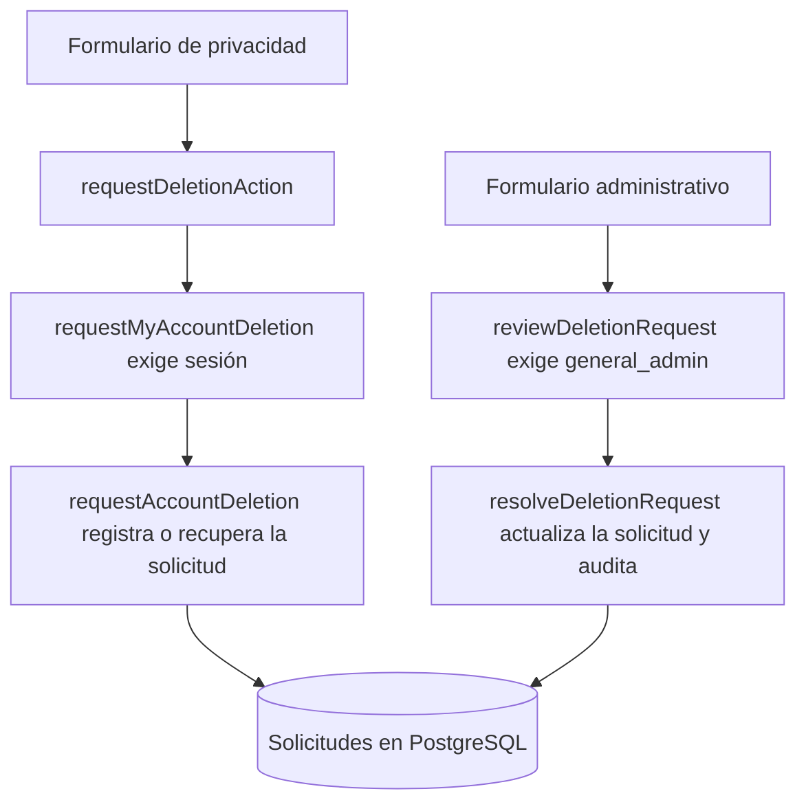

# Perfiles, talento y privacidad

[Volver al mapa del backend](README.md)

El perfil básico corresponde a la cuenta de Comunidad. El perfil de talento es voluntario y guarda información profesional adicional. En privacidad, cada persona puede decidir sobre la difusión de su perfil de talento y solicitar la supresión de su cuenta. El panel administrativo usa capacidades diferentes para consultar talento y tramitar solicitudes.

## Puntos de entrada

| Página | Lectura y acceso |
| --- | --- |
| [`/profile`](../../src/app/profile/page.jsx) | `ProfilePage` llama a `getMyProfile`, que exige sesión y consulta el perfil propio y los borrados de fotos pendientes. La página presenta los datos editables y un resumen de la foto. `AvatarForm` abre el diálogo «Tu foto de perfil» con el selector, la vista previa, el banner de Avatar Studio y el control de retirada o reintento según el estado. |
| [`GET /api/profile/avatar`](../../src/app/api/profile/avatar/route.ts) | Llama a `readMyProfileAvatar`, responde `401` sin sesión o `404` sin foto, y sirve el binario propio con `Cache-Control: no-store` y `X-Content-Type-Options: nosniff`. |
| [`/profile/talent`](../../src/app/profile/talent/page.jsx) | `TalentProfilePage` llama a `getMyTalentProfile`. La operación obtiene la identidad de la sesión y la usa como solicitante y titular en `getTalentProfile`. |
| [`/profile/privacy`](../../src/app/profile/privacy/page.jsx) | `ProfilePrivacyPage` llama a `getMyPrivacySettings`. La operación comprueba la sesión y carga ambas lecturas en paralelo. |
| [`/admin/talent`](../../src/app/admin/talent/page.jsx) | `AdminTalentPage` lee los filtros de la URL y llama a `searchTalentForConsultation`, que exige `talent_consultation`. |
| [`/admin/talent/[id]`](../../src/app/admin/talent/%5Bid%5D/page.jsx) | `AdminTalentDetailPage` llama a `getTalentForConsultation(id)`, que exige `talent_consultation`. Devuelve 404 si falta el perfil. |
| [`GET /api/admin/talent/[id]/avatar`](../../src/app/api/admin/talent/%5Bid%5D/avatar/route.ts) | Llama a `readTalentAvatarForConsultation(id)` verificando `talent_consultation` y la existencia de fila en `talent_profiles`; devuelve `404` en cualquier denegación o ausencia. Todas las respuestas usan `Cache-Control: no-store`. |
| [`/admin/deletion-requests`](../../src/app/admin/deletion-requests/page.jsx) | `AdminDeletionRequestsPage` llama a `listDeletionRequestsForReview`, que exige `general_admin` y carga la cola. |
| [`/admin/deletion-requests/[id]`](../../src/app/admin/deletion-requests/%5Bid%5D/page.jsx) | `AdminDeletionRequestDetailPage` llama a `getDeletionRequestForReview(id)`, que exige `general_admin`. La página devuelve 404 si falta. Los formularios invocan la acción de tramitarla. |

## De la página a la operación autorizada

Las acciones de Next.js leen `FormData` y deciden qué pantalla mostrar después. Las operaciones obtienen del servidor la identidad y la capacidad del usuario. Los repositorios reciben esos identificadores y aplican las reglas de datos al consultar o guardar.

### Acciones de `/profile`

[Código de las acciones de perfil](../../src/app/profile/actions.ts)

| Función | Qué hace |
| --- | --- |
| `textField(formData, key)` | Lee el campo de texto. Devuelve una cadena vacía si el valor falta o es un archivo. |
| `optionalTextField(formData, key)` | Devuelve `undefined` si falta texto, de modo que el repositorio puede distinguir un campo omitido de uno vacío. |
| `saveBasicProfileAction(formData)` | Lee los campos editables y los posibles campos de identidad que envíe la petición. Llama a `updateMyProfile` y redirige a `/profile` con `saved` o el código de error. |
| `uploadProfileAvatarAction(formData)` | Pasa el campo `avatar` a `uploadMyProfileAvatar`, revalida el menú de cuenta de `Navbar`, `/profile` y `/admin/talent` tras guardar en Neon Object Storage y redirige con `avatar_saved` o el código de error. |
| `removeProfileAvatarAction()` | Llama a `removeMyProfileAvatar` y redirige a `/profile` con `avatar_removed` o el código de error. Revalida las vistas compartidas tanto si termina la retirada como si queda pendiente el borrado físico. En ese caso, la página ofrece «Completar retirada». |
| `saveTalentProfileAction(formData)` | Construye enlaces con sus tipos y etiquetas, admite `graduationYear` como campo anterior, interpreta etiquetas e idiomas y llama a `saveMyTalentProfile`. La vista de talento muestra el resultado tras la redirección. |
| `updateDisseminationAction(formData)` | Pasa el valor de `granted` a `updateMyDissemination`; redirige a privacidad con la decisión aplicada o el error. |
| `requestDeletionAction(formData)` | Envía el motivo a `requestMyAccountDeletion` y redirige a privacidad indicando si se creó la solicitud o ya había una abierta. |

### Acción de tramitación

[Código de la acción administrativa de supresión](../../src/app/admin/deletion-requests/actions.ts)

| Función | Qué hace |
| --- | --- |
| `readField(form, name)` | Lee y recorta el texto. Usa una cadena vacía para otros valores. |
| `resolveDeletionRequestAction(formData)` | Lee el ID, el estado y la nota. Selecciona `resolved` solo para ese valor exacto y `in_review` para el resto. Llama a `reviewDeletionRequest`. Si falta el ID vuelve al listado. En los demás casos revalida detalle, listado, panel y privacidad, y redirige al detalle con el resultado. |

### Operaciones con identidad

[Código de las operaciones](../../src/server/profiles/operations.ts) · [Origen de la sesión y las capacidades](auth.md)

| Función | Qué hace |
| --- | --- |
| `updateMyProfile(input)` | Exige sesión y pasa el `personId` autenticado y los campos a `updateBasicProfile`. |
| `uploadMyProfileAvatar(input)` | Exige sesión antes de validar el tamaño (2 MiB) o leer bytes; delega en `uploadProfileAvatar` con el adaptador `getAvatarStorage()`. |
| `removeMyProfileAvatar()` | Exige sesión y llama a `removeProfileAvatar` para desreferenciar el objeto y reintentar su borrado. |
| `readMyProfileAvatar()` | Comprueba la sesión con `currentUser()` y devuelve `{ authenticated: false }` o el binario leído con `readProfileAvatar`. |
| `readTalentAvatarForConsultation(id)` | Exige cuenta activa con `talent_consultation` y lee el avatar únicamente si la candidatura tiene fila en `talent_profiles`. |
| `saveMyTalentProfile(input)` | Exige sesión y llama a `saveTalentProfile` con el `personId` autenticado. |
| `updateMyDissemination(decision)` | Exige sesión, admite exactamente los textos `"true"` y `"false"` y guarda el booleano. Devuelve `invalid_decision` para otros valores y `missing` si el perfil desapareció. |
| `requestMyAccountDeletion(reason)` | Exige sesión y solicita la supresión para el `personId` autenticado. |
| `reviewDeletionRequest(requestId, status, resolutionNote)` | Exige `general_admin` y usa el `personId` del administrador como autor de la operación. Devuelve `null` para un ID vacío. El repositorio valida y guarda el cambio. |

## Perfil básico y talento en PostgreSQL

[Código del repositorio](../../src/server/profiles/repository.ts)

| Función | Qué hace |
| --- | --- |
| `resolveDb(db?)` | Usa la conexión recibida, por ejemplo PGlite en una prueba, o obtiene la de la aplicación con `getDb()`. |
| `toBasicProfile(row)` | Proyecta la fila de `profiles` a los datos del perfil básico y representa con `null` los campos opcionales sin valor. |
| `getBasicProfile(personId, db?)` | Comprueba que el ID tiene formato UUID, consulta por ID y devuelve la proyección o `null`. |
| `updateBasicProfile(personId, input, db?)` | Bloquea la fila durante la actualización. Comprueba la identidad y el correo existentes, rechaza cambios en ellos y valida los campos editables. Conserva los valores académicos opcionales omitidos. Devuelve el perfil guardado o `missing`, `email_immutable`, `identity_immutable` o `fields`. |
| `getTalentProfile(requesterId, targetPersonId, db?)` | Exige coincidencia entre solicitante y titular, y un perfil básico existente. Devuelve los datos de talento, incluido un perfil vacío para quien aún no haya guardado el formulario. |
| `saveTalentProfile(personId, input, db?)` | Valida los campos, comprueba que existe el titular y guarda una fila por persona mediante un *upsert*. Inserta si es el primer guardado y actualiza si ya hay fila. Relee el perfil dentro de la transacción. |
| `readTalentProfileRow(db, personId)` | Lee la fila de talento y devuelve los datos de la vista, con experiencias ordenadas por `sortOrder`. Si falta la fila, devuelve el perfil vacío con listas vacías y fechas nulas. |
| `mapExperienceFromDb(item)` | Convierte una experiencia JSONB de `is_featured` y `sort_order` a `isFeatured` y `sortOrder`. También normaliza organización y descripción ausentes. |
| `mapExperienceToDb(item)` | Convierte una experiencia validada al formato de claves que guarda PostgreSQL. |
| `isSafeHttpUrl(raw)` | Admite URLs absolutas con host y esquema HTTP o HTTPS, hasta 2048 caracteres y sin espacios ni caracteres de control. |
| `normalizeTagList(tags)` | Recorta las etiquetas, pasa a minúsculas y elimina vacías y duplicados respetando el orden de aparición. La búsqueda interna comparte esta normalización. |
| `parseTagList(raw)` | Divide el texto de un formulario por comas o saltos de línea y lo pasa a `normalizeTagList`. |
| `validateTagCategory(tags)` | Valida textos y deduplica. El límite es de 20 etiquetas distintas por categoría y 60 caracteres por etiqueta. Devuelve `null` para una categoría inválida. |
| `parseLanguageList(raw)` | Convierte texto o listas de texto en pares de idioma y nivel. Admite `Inglés (B2)`, `Inglés - B2` e `Inglés: B2`. Si solo se indica el idioma usa «No especificado». |
| `parseExperiencesFromText(input)` | Convierte el proyecto destacado y el resumen libre en experiencias estructuradas, con tipo, orden y marca de destacado. |
| `parseExpectedGraduationYear(value)` | Admite año entero de 1950 a 2100, una cadena de cuatro dígitos en el mismo rango o un valor vacío que se guarda como `null`. |

`saveTalentProfile` valida además las experiencias, los tipos y etiquetas de enlaces y los idiomas. Devuelve códigos como `invalid_year`, `invalid_url` o `duplicate_language` para que la vista explique el error. Los perfiles básico y de talento tienen escrituras propias y la decisión de difusión se registra en su tabla.

## Difusión y consulta interna

[Código del repositorio](../../src/server/profiles/repository.ts) · [Código de consulta de talento](../../src/server/profiles/talent-consultation.ts)

| Función | Qué hace |
| --- | --- |
| `readDisseminationStatus(db, personId, now)` | Lee el historial para el propósito de difusión y lo ordena por fecha e ID descendentes. Calcula la vigencia de la última decisión. La difusión queda desactivada si no hay decisión o la concesión ha caducado. |
| `getDisseminationStatus(personId, now?, db?)` | Abre la conexión y devuelve el estado y el historial usados en privacidad. |
| `setDisseminationDecision(personId, granted, options?, db?)` | Bloquea el perfil, compara la última decisión con la nueva y conserva el historial sin duplicar una decisión equivalente con la misma vigencia y versión de política. Inserta un evento al cambiar la decisión. |
| `resolveDb(db?)` | En `talent-consultation.ts`, elige la conexión de consulta recibida o `getDb()`. |
| `readLatestDisseminationMap(db, personIds, now)` | Consulta en bloque las decisiones de los perfiles solicitados, conserva la más reciente por persona y calcula su vigencia. |
| `searchTalentProfiles(filters?, db?)` | Une perfil de talento y perfil básico. Aplica solapamiento de etiquetas en SQL y filtra el texto libre sobre los campos de búsqueda. Devuelve resúmenes con el indicador de difusión y el número de enlaces. |
| `getTalentAdminDetail(personId, db?, now?)` | Devuelve el detalle por UUID, con experiencias ordenadas, enlaces y datos de la decisión de difusión. Si falta la fila de talento, devuelve `null`. |

La búsqueda y la ficha administrativa se protegen con `talent_consultation`. La decisión de difusión se muestra como información del perfil. Estas lecturas internas incluyen perfiles con y sin difusión activa.

## Foto de perfil privada y Neon Object Storage

El [diálogo de la foto](../../src/app/profile/avatar-form.jsx) muestra los formatos de entrada aceptados y el límite de 2 MiB. Si la acción devuelve un error de foto, la página abre el diálogo para mostrarlo. Cerrar el diálogo descarta el archivo seleccionado. El [banner de Avatar Studio](../../src/components/avatar/AvatarStudioBanner.jsx) enlaza al estudio en otra pestaña y muestra ejemplos de avatares.

[Validación de avatares](../../src/server/profiles/avatar-validation.ts) · [Procesamiento de imágenes](../../src/server/profiles/avatar-image.ts) · [Cola de borrados](../../src/server/profiles/avatar-cleanup.ts) · [Repositorio de avatar](../../src/server/profiles/avatar.ts) · [Utilidades HTTP](../../src/server/profiles/avatar-http.ts) · [Cliente S3 para Neon](../../src/server/storage/neon-object-storage.ts) · [Selector de almacenamiento](../../src/server/storage/avatar-storage.ts)

| Módulo / Función | Responsabilidad |
| --- | --- |
| `validateAvatarBytes(bytes)` | Exige entre 1 byte y 2 MiB y comprueba la firma binaria de JPEG, PNG o WebP.
| `prepareAvatarImage(bytes)` | Decodifica con Sharp, verifica el formato real y rechaza archivos malformados, animados o de más de 25 millones de píxeles. Aplica la orientación EXIF, convierte a sRGB y ajusta a 512 × 512 píxeles como máximo conservando la proporción y sin ampliar. Codifica los píxeles sin metadatos de origen en WebP (calidad 80) y AVIF (55) y conserva el menor archivo. En empate elige WebP. |
| `buildOwnAvatarUrl` / `buildTalentAvatarUrl` | Generan `/api/profile/avatar?v=<epochMs>` y `/api/admin/talent/<id>/avatar?v=<epochMs>` sin exponer `avatar_key` ni URLs S3 en el navegador. |
| `signS3Request` / `createNeonObjectStorage` | Implementa firma AWS SigV4 sobre `fetch` con direccionamiento path-style para buckets privados de Neon Object Storage. |
| `getAvatarStorage()` | Resuelve disco temporal en Playwright (`AD_ASTRA_AVATAR_TEST_DIR`), memoria en `node:test` o Neon Object Storage si están definidas `AWS_ENDPOINT_URL_S3`, `AWS_ACCESS_KEY_ID`, `AWS_SECRET_ACCESS_KEY` y `NEON_STORAGE_BUCKET` (`AWS_REGION` es opcional y se deduce del endpoint). |
| `buildEmptyNoStoreResponse` / `buildPrivateAvatarResponse` | Aplican `Cache-Control: no-store` a `200`, `401` y `404`. El `200` con el binario incluye `nosniff`, `Content-Disposition: inline` y `Vary: Cookie`. |
| `uploadProfileAvatar` | Registra una tarea para la clave nueva antes de subir los bytes procesados. Bloquea esa tarea y el perfil durante la subida. En la misma transacción actualiza la referencia, encola la clave anterior si existe y elimina la tarea de la foto nueva. Si la transacción se revierte, queda la tarea que permite limpiar el objeto nuevo. |
| `removeProfileAvatar` | Desreferencia la foto y encola su clave en una misma transacción. Después intenta el borrado físico. Si Storage no está disponible o falla la limpieza, devuelve `cleanup_pending` y se puede volver a intentar. |
| `hasAvatarDeletions` / `flushAvatarDeletions` | Consultan la cola `avatar_deletions` y reintentan el borrado de objetos pendientes. El ejecutor comprueba que la clave ya no esté referenciada y retira la tarea al confirmar el borrado. Si falla, conserva la tarea para otro intento. |
| `readProfileAvatar` / `readTalentProfileAvatar` | Validan la clave almacenada (`AVATAR_KEY_PATTERN`) y recuperan el binario privado; la lectura de talento exige unión con `talent_profiles`. |

El script [`npm run avatars:cleanup`](../../scripts/cleanup-avatars.ts) reintenta la cola completa con la base y el bucket configurados. Devuelve un código de salida distinto de cero si la limpieza requiere otro intento. La columna `avatar_key` admite las extensiones de fotos anteriores y las actuales (`.jpg`, `.png`, `.webp` y `.avif`).

## Solicitudes de supresión

[Código del repositorio de supresión](../../src/server/profiles/deletion-requests.ts)

| Función | Qué hace |
| --- | --- |
| `resolveDb(db?)` | Usa la conexión inyectada o la configurada por la aplicación. |
| `getPgErrorCode(error)` | Busca el código de PostgreSQL en el error o en su causa. Permite reconocer una restricción de unicidad aunque el driver haya envuelto el error. |
| `mapDeletionRequest(row)` | Convierte la fila en los datos que necesita el solicitante, con motivo vacío o nota, autor y fecha de resolución opcionales. |
| `requestAccountDeletion(personId, reason?, now?, db?)` | Valida el UUID y el motivo de hasta 1000 caracteres. Bloquea el perfil y devuelve la petición abierta si ya existe. Si procede, crea una solicitud `pending`. Ante una colisión de unicidad vuelve a leer la solicitud abierta. |
| `getMyDeletionRequest(requesterId, targetPersonId?, db?)` | Comprueba que solicitante y titular coinciden. Prefiere una solicitud abierta y, dentro de ese orden, la más reciente. |
| `queryDeletionRequests(db, requestId?)` | Une solicitud, titular y posible persona que resolvió. Obtiene el detalle si recibe un ID. En la cola, coloca primero `pending`, luego `in_review` y después las resueltas, con orden descendente por fecha dentro de cada grupo. |
| `listDeletionRequests(db?)` | Devuelve la cola administrativa desde `queryDeletionRequests`. |
| `getDeletionRequest(requestId, db?)` | Valida el UUID y devuelve el detalle administrativo o `null`. |
| `resolveDeletionRequest(requestId, status, resolutionNote, actorProfileId, now?, db?)` | Valida entradas, bloquea la solicitud y comprueba si ya está resuelta y si existe el autor. El paso a `resolved` exige una nota de 1 a 2000 caracteres y una fecha válida. Guarda estado y auditoría juntos y relee la solicitud para responder. |

### Utilidades compartidas de identidad

[Código de las utilidades](../../src/server/profiles/identity.ts)

| Función | Qué hace |
| --- | --- |
| `isUuid(value)` | Comprueba el formato hexadecimal con guiones antes de consultar una columna UUID. |
| `formatName(firstName, lastName)` | Junta y recorta nombre y apellidos para las vistas administrativas. |
| `profileExists(db, personId)` | Valida el ID y consulta si existe la fila de perfil, usando también una transacción cuando la recibe. |

## Ejemplo de principio a fin

Al pulsar «Solicitar supresión» en privacidad, `requestDeletionAction` lee el motivo. `requestMyAccountDeletion` obtiene el titular de la sesión y `requestAccountDeletion` comprueba si ya hay una solicitud en curso antes de insertar. Al volver a privacidad, `getMyDeletionRequest` lee lo persistido. Para tramitarla desde administración, `reviewDeletionRequest` exige `general_admin` y el repositorio guarda la resolución y su auditoría en una transacción. La operación cierra la solicitud registrada. La ejecución material de la supresión queda fuera de esa transición.

Para cambiar campos editables o su validación, empieza por las acciones y el repositorio de perfil. Para tocar la transición de supresión, empieza por `deletion-requests.ts` y sigue la operación y acción administrativa. Las comprobaciones de persistencia y avatares viven en [las pruebas del repositorio](../../src/server/profiles/repository.test.ts), [las pruebas de avatar](../../src/server/profiles/avatar.test.ts) y [las pruebas de Neon Object Storage](../../src/server/storage/neon-object-storage.test.ts). Las pantallas de perfil y las capacidades administrativas se recorren en [oportunidades y perfil](../../e2e/opportunities-and-profile.spec.ts) y [administración y acceso](../../e2e/admin-and-auth.spec.ts).

## Lecturas autorizadas en `operations.ts`

Estas funciones se ejecutan en el servidor. La página las llama directamente para renderizar. La función comprueba la sesión o la capacidad antes de consultar los datos.

| Función | Parámetros | Uso y resultado |
| --- | --- | --- |
| `getMyProfile` | Sin parámetros | Exige sesión e identifica al titular. Lee `getBasicProfile` y `hasAvatarDeletions` en paralelo y entrega a `ProfilePage` los datos básicos y `avatarCleanupPending`. |
| `getMyTalentProfile` | Sin parámetros | Exige sesión y lee el talento propio con `getTalentProfile`. Entrega los datos a `TalentProfilePage`. |
| `getMyPrivacySettings` | Sin parámetros | Exige sesión una sola vez, consulta la difusión y la solicitud de supresión en paralelo y entrega ambas a `ProfilePrivacyPage`. |
| `searchTalentForConsultation` | `filters` con texto o etiquetas | Exige `talent_consultation` y entrega a la página de resultados lo que devuelve `searchTalentProfiles`. |
| `getTalentForConsultation` | `id` del perfil | Exige `talent_consultation` y llama a `getTalentAdminDetail`. Devuelve el detalle o `null`. |
| `listDeletionRequestsForReview` | Sin parámetros | Exige `general_admin` y devuelve la cola de solicitudes consultada por `listDeletionRequests`. |
| `getDeletionRequestForReview` | `id` de la solicitud | Exige `general_admin`, consulta la solicitud con `getDeletionRequest` y devuelve un detalle o `null`. |

## Helpers de presentación de las páginas JSX

Estos helpers se ejecutan al renderizar. Convierten datos del servidor en texto de formulario.

| Función | Parámetros | Resultado y llamador |
| --- | --- | --- |
| `formatDateTime` | `timestamp` con la fecha de un evento | `ProfilePrivacyPage` usa la fecha formateada para el historial. |
| `firstLinkByKind` | Colección `links` y su tipo `kind` | Devuelve el primer vínculo de ese tipo o `undefined`. `TalentProfilePage` lo usa para rellenar los campos de enlaces. |
| `formatFeaturedProject` | Experiencias del perfil | Devuelve la descripción o el título de la experiencia destacada, o texto vacío. Rellena el campo de proyecto destacado. |
| `formatExperiencesSummary` | Experiencias del perfil | Une en texto las experiencias ordinarias para el campo de resumen. |
| `formatLanguages` | Lista de idiomas y niveles | Devuelve una lista en texto, con nivel si está indicado, para rellenar el campo del formulario. |
